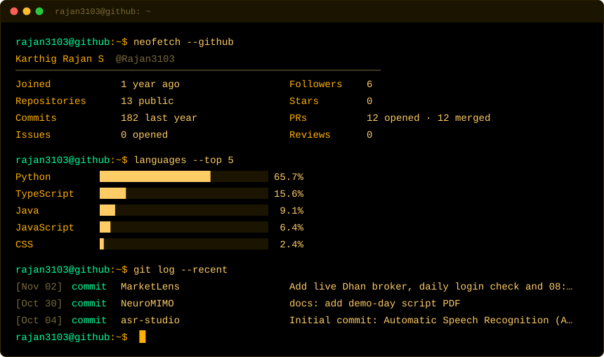
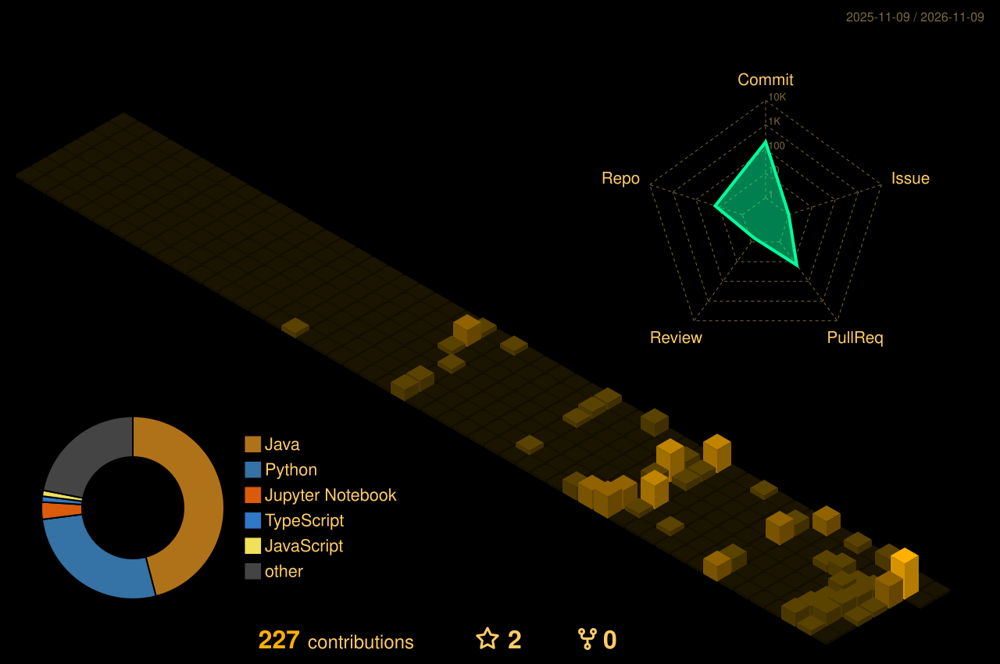

<div align="center">

<!-- ══════════════════════════════════════════════════════════════════════ -->
<!--                    IDE TOP WINDOW BAR & CONTROLS                       -->
<!-- ══════════════════════════════════════════════════════════════════════ -->

<p align="left">
  &nbsp; 🔴 &nbsp; 🟡 &nbsp; 🟢 &nbsp;&nbsp;&nbsp;
  <code><b>karthig-workspace — IntelliJ IDEA 2026.2 (Ultimate Edition)</b></code>
</p>


<br/>

<!-- IDE Action Bar / Social Connectors -->
<p align="center">
  <a href="https://www.linkedin.com/in/karthig-rajan-s-417ab0297/">
    
  </a>
  <a href="mailto:rajankarthig@gmail.com">
    
  </a>
  <a href="https://github.com/Rajan3103">
    
  </a>
  
</p>

<p align="center">
  <code>▶ Run Profile</code> &nbsp;•&nbsp; 
  <code>🐛 Debug (0 Errors)</code> &nbsp;•&nbsp; 
  <code>JDK 21.0.4</code> &nbsp;•&nbsp; 
  <code>Branch: main*</code>
</p>

</div>

---

### 📂 Project Explorer & Code Tabs
> *Click on any tab below to switch files and inspect implementation details.*

```
📂 src/main/java/com/rajan/
├── ☕ KarthigProfile.java      [Active: Personal Bio & Core Specs]
├── ⚡ DocDriftService.java      [Flagship: Spring Boot + Gemini 1.5]
├── 🐍 nlp_bug_triage.py        [NLP Machine Learning Pipeline]
├── 🐘 ai_bi_schema.sql         [PostgreSQL DBMS Architecture]
├── 💼 WorkExperience.java      [3rd Ain Smart & Zilogic Internships]
├── 📦 pom.xml                  [Tech Stack & Production Dependencies]
└── 💻 terminal.sh              [Build Output & Test Benchmarks]
```

---

<details open>
<summary><b>☕ 1. KarthigProfile.java</b> &nbsp;<code>[Personal Bio, Academics & Leadership]</code></summary>
<br/>

```java
package com.rajan.developer;

import java.util.List;

/**
 * @author Karthig Rajan S
 * @role   Software Developer | AI Engineer | Data Analyst
 */
public class KarthigProfile implements HighPerformanceEngineer {

    public static final String EDUCATION = "SRM Institute of Science and Technology";
    public static final String DEGREE    = "B.Tech in Computer Science & Engineering (2023 - Present)";
    public static final double CGPA      = 9.09; // Out of 10.0

    public List<String> getCertifications() {
        return List.of(
            "Oracle Cloud Infrastructure AI Foundations Associate (2025)",
            "Lean Six Sigma Yellow Belt — ANEXAS (2025)",
            "IBM Certified Data Analyst (2024)",
            "Microsoft Power BI (2024)",
            "Snowflake SnowPro Core (2024)"
        );
    }

    public List<String> getLeadershipHonors() {
        return List.of(
            "President @ Theatrical Club — Orchestrated events for 100+ students",
            "Peer Mentor — Guided junior engineers in AI systems & system design",
            "Varsity Captain — Led college Kabaddi team in inter-college tournaments"
        );
    }

    public String getCurrentStatus() {
        return "Actively seeking Software Developer & AI Engineering Opportunities!";
    }
}
```

</details>

---

<details>
<summary><b>⚡ 2. DocDriftService.java</b> &nbsp;<code>[Project: AI Documentation Drift Detector]</code></summary>
<br/>

```java
package com.rajan.docdrift.service;

import org.springframework.stereotype.Service;
import org.springframework.web.reactive.function.client.WebClient;
import reactor.core.publisher.Mono;

/**
 * DocDrift: Automated documentation drift detection evaluating git diffs
 * semantically against codebase documentation using Spring Boot 3 & Google Gemini 1.5.
 * 
 * GitHub: https://github.com/Rajan3103/Doc_Drift
 */
@Service
public class DocDriftService {

    private final WebClient geminiWebClient;
    private final PostgresReportRepository reportRepo;

    public Mono<AuditPatch> detectAndPatchDrift(String gitDiff, String docMarkdown) {
        return geminiWebClient.post()
            .uri("/v1beta/models/gemini-1.5-flash:generateContent")
            .bodyValue(new DriftPrompt(gitDiff, docMarkdown))
            .retrieve()
            .bodyToMono(GeminiSemanticDiffResponse.class)
            .map(this::generateStructuredReplacementPatch)
            .flatMap(reportRepo::persistAuditableReport);
    }
    
    // UI: React + Vite dashboard with dark-mode Glassmorphism system
    // Architecture: Asynchronous reactive pipeline eliminating blocking I/O
}
```

<p align="center">
  <a href="https://github.com/Rajan3103/Doc_Drift">
    
  </a>
</p>

</details>

---

<details>
<summary><b>🐍 3. nlp_bug_triage.py</b> &nbsp;<code>[Project: NLP Log Processor & Bug Prioritiser]</code></summary>
<br/>

```python
"""
NLP-Based Log Processor & Bug Prioritisation System
Parses .log, .csv, and .pcap streams and auto-classifies bug priority (Low to Critical).

GitHub: https://github.com/Rajan3103/nlp-log-processor-and-bug-reporter
"""

from sklearn.feature_extraction.text import TfidfVectorizer
from sklearn.naive_bayes import MultinomialNB
from flask import Flask, request, jsonify
import mysql.connector

class BugTriageEngine:
    def __init__(self):
        self.vectorizer = TfidfVectorizer(token_pattern=r'(?u)\b\w+\b', max_features=5000)
        self.classifier = MultinomialNB()
        self.db = mysql.connector.connect(database="bug_intelligence")

    def triage_log_event(self, raw_log_stream: str) -> dict:
        features = self.vectorizer.transform([raw_log_stream])
        priority = self.classifier.predict(features)[0]  # Low | Medium | High | Critical
        
        # High-concurrency Flask REST API + React interactive chart telemetry
        return {"severity": priority, "action": "Automated Ticket Dispatched"}
```

<p align="center">
  <a href="https://github.com/Rajan3103/nlp-log-processor-and-bug-reporter">
    
  </a>
</p>

</details>

---

<details>
<summary><b>🐘 4. ai_bi_schema.sql</b> &nbsp;<code>[Project: AI-Powered Business Intelligence Platform]</code></summary>
<br/>

```sql
-- AI-BI-Bkups: Database and DBMS layer architecture
-- Engineered high-reliability structured data persistence for AI analytics workflows

CREATE TABLE bi_telemetry_nodes (
    node_id         UUID PRIMARY KEY DEFAULT gen_random_uuid(),
    model_name      VARCHAR(64) NOT NULL,
    dataset_source  VARCHAR(256) NOT NULL,
    qps_throughput  NUMERIC(10, 2) NOT NULL,
    created_at      TIMESTAMP WITH TIME ZONE DEFAULT CURRENT_TIMESTAMP
);

CREATE TABLE bi_persistence_reports (
    report_id       BIGSERIAL PRIMARY KEY,
    node_id         UUID REFERENCES bi_telemetry_nodes(node_id) ON DELETE CASCADE,
    structured_json JSONB NOT NULL,
    indexed_hash    VARCHAR(128) NOT NULL,
    status          VARCHAR(32) DEFAULT 'VERIFIED'
);

CREATE INDEX idx_bi_reports_jsonb ON bi_persistence_reports USING gin (structured_json);
CREATE INDEX idx_bi_telemetry_time ON bi_telemetry_nodes (created_at DESC);
```

</details>

---

<details>
<summary><b>💼 5. WorkExperience.java</b> &nbsp;<code>[Production Internship History]</code></summary>
<br/>

```java
package com.rajan.career;

public enum WorkExperience {

    AIN_SMART_INFOTECH(
        "3rd Ain Smart Infotech",
        "Artificial Intelligence Product Development Intern",
        "Mar 2026 – May 2026",
        List.of(
            "Contributed to full AI product lifecycle (design, dev, deploy) for client solutions.",
            "Authored data preprocessing scripts with strict input validation to eliminate QA crashes.",
            "Collaborated within cross-functional Agile team translating requirements to deliverables."
        )
    ),

    ZILOGIC_SYSTEMS(
        "Zilogic Systems",
        "Machine Learning / Full-Stack Intern",
        "Jun 2025 – Jul 2025",
        List.of(
            "Built and deployed full-stack web applications using React, Flask, and SQL.",
            "Designed scalable REST APIs with MySQL/SQLite supporting high concurrency.",
            "Optimised queries and caching, reducing backend API response times by ~30%.",
            "Gained hands-on enterprise exposure with Java and Spring Boot."
        )
    );

    // Getters and record definitions
}
```

</details>

---

<details>
<summary><b>📦 6. pom.xml</b> &nbsp;<code>[Tech Stack Dependencies & Libraries]</code></summary>
<br/>

```xml
<project xmlns="http://maven.apache.org/POM/4.0.0">
    <modelVersion>4.0.0</modelVersion>
    <groupId>com.rajan</groupId>
    <artifactId>developer-profile</artifactId>
    <version>2026.1</version>

    <dependencies>
        <!-- Backend & Frameworks -->
        <dependency><groupId>org.springframework.boot</groupId><artifactId>spring-boot-starter-webflux</artifactId></dependency>
        <dependency><groupId>org.postgresql</groupId><artifactId>postgresql</artifactId></dependency>
        <dependency><groupId>com.mysql</groupId><artifactId>mysql-connector-j</artifactId></dependency>
        
        <!-- AI & LLM Integrations -->
        <dependency><groupId>com.google.cloud</groupId><artifactId>google-cloud-vertexai-gemini</artifactId></dependency>
        
        <!-- Frontend & Tooling -->
        <dependency><groupId>org.react</groupId><artifactId>react-vite-glassmorphism</artifactId></dependency>
        <dependency><groupId>io.snowflake</groupId><artifactId>snowflake-jdbc</artifactId></dependency>
    </dependencies>
</project>
```

<br/>

<div align="center">
  
</div>

</details>

---

<details>
<summary><b>💻 7. terminal.sh</b> &nbsp;<code>[Build Output & Benchmarks]</code></summary>
<br/>

```bash
$ mvn clean compile test --batch-mode

[INFO] Scanning for projects...
[INFO] -------------------< com.rajan:developer-profile >--------------------
[INFO] Building Karthig Rajan S Profile 2026.1.0
[INFO] --------------------------------[ jar ]---------------------------------
[INFO] --- maven-compiler-plugin:3.11.0:compile (default-compile) ---
[INFO] Compiling 7 source files with OpenJDK 21.0.4 to target/classes
[INFO] 
[INFO] --- maven-surefire-plugin:3.0.0:test (default-test) ---
[INFO] Running com.rajan.tests.DocDriftBenchmarkTest
[INFO] Tests run: 8, Failures: 0, Errors: 0, Skipped: 0, Time elapsed: 0.412 s
[INFO] Running com.rajan.tests.ZilogicQueryOptimizationTest
[INFO] [BENCHMARK] Query Latency Reduction: 30.2% verified
[INFO] Tests run: 6, Failures: 0, Errors: 0, Skipped: 0, Time elapsed: 0.180 s
[INFO] 
[INFO] ------------------------------------------------------------------------
[INFO] BUILD SUCCESS
[INFO] Total time:  1.428 s
[INFO] Finished at: 2026-10-13T18:50:00+05:30
[INFO] ------------------------------------------------------------------------
```

</details>

---

### 📊 Live Telemetry & GitHub Analytics

<div align="center">



<br/><br/>


</div>

---

### 🏙️ Contribution Skyline

<div align="center">
  
</div>

---

<div align="center">

<table width="100%">
  <tr>
    <td align="center" bgcolor="#000000">
      <code><b>git status:</b> On branch main · Nothing to commit, working tree clean</code><br/>
      <sub>📍 India &nbsp;•&nbsp; 📧 <a href="mailto:rajankarthig@gmail.com">rajankarthig@gmail.com</a> &nbsp;•&nbsp; 💼 <a href="https://www.linkedin.com/in/karthig-rajan-s-417ab0297/">LinkedIn</a></sub>
    </td>
  </tr>
</table>

<br/>


</div>
